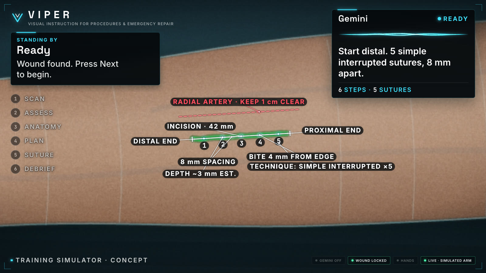
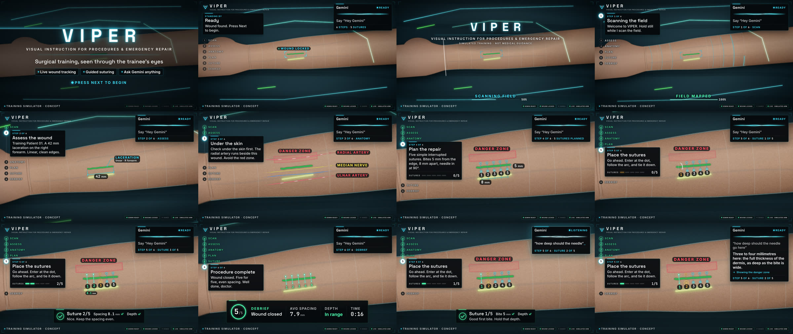
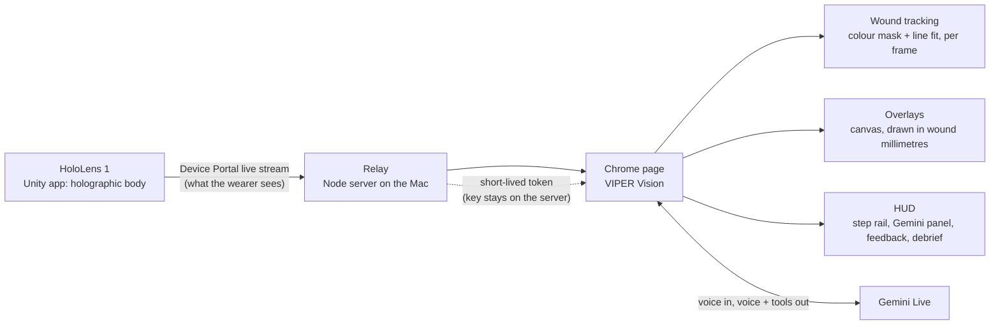

<div align="center">

# VIPER

### Visual Instruction for Procedures & Emergency Repair

A surgical suture trainer for HoloLens. The trainee sees a holographic patient through the headset.<br>
Everyone else sees the trainee's own view, with the repair drawn onto the real arm<br>
and a Gemini attending they can talk to.


**[Try it in two minutes](#try-it-in-two-minutes-no-headset-needed)** · **[How it works](#how-it-works)** · **[What is real](#what-is-real-and-what-is-scripted)** · **[Repo map](#repo-map)**



<sub>Built in a weekend at UCSC DevFest 2026 · Training simulator, concept · Not medical guidance</sub>

</div>

## What it does

| | |
|---|---|
| **Follows a real line on a real arm** | A green marker line stands in for the wound. VIPER Vision finds it in the headset's live video, ignores the holograms around it, and pins every overlay to it in millimetres, so the drawing moves with the arm. |
| **Walks through a repair** | Scan, assess, what is under the skin, plan, five sutures, debrief: a step rail, targets on the wound, a card that confirms each suture, and a debrief at the end. One key (`K`) scans and annotates the line in one go. |
| **Has an attending you can talk to** | Say "Hey Gemini" (or hold a button) and ask. Gemini Live hears the question, sees the trainee's view when it needs to, answers out loud and in writing, and can point at a structure or move the procedure on. It cannot place or skip a suture. |
| **Is built for a demo table** | Lettering sized to read from two metres, an idle screen between groups, a clicker and a phone remote, and fallbacks (webcam, recorded clip, simulated arm) if the headset drops. |



## How it works



| Part | Built with |
|------|------------|
| VIPER Vision (`vision/`) | TypeScript, Vite, Canvas 2D, Motion, MediaPipe Hands, a small Node server |
| Attending | Gemini Live API (`@google/genai`), short-lived tokens, Chrome Web Speech API for the wake phrase |
| HoloLens app (`Assets/`) | Unity 2019.4, C# 7.3, built-in render pipeline, Windows Mixed Reality |

## Try it in two minutes (no headset needed)

```bash
cd vision
npm install
npm run dev          # http://localhost:4747
```

Open `http://localhost:4747/?input=sim` in Chrome for the simulated arm.

| Key | Does |
|-----|------|
| `Space` (or a clicker) | Next step. Hold it to talk to Gemini when a session is open. |
| `K` | Scan the line, then annotate it. Again clears. |
| `R` | Reset to the idle screen |
| `F` | Full screen |
| `?` | Every other key |

With a headset and a Gemini key: copy `vision/.env.example` to `vision/.env.local`, fill it in, and follow
[`docs/MORNING.md`](docs/MORNING.md). Open `http://localhost:4747/?input=hololens`.

## What is real and what is scripted

| Real | Scripted for this concept |
|------|---------------------------|
| The live stream from the headset | The patient |
| Tracking of the line: position, direction, scale | The "42 mm" (the marker's known length, which sets the scale) |
| The overlays following the arm | Per-suture spacing and depth read-outs |
| Hand detection | The debrief numbers |
| Every Gemini answer | |

The screen says "Training simulator · concept" in every state.

Measured on the build: 60 fps through a full run with 0 slow frames in 3,433, and 96 back-to-back runs over 90
minutes with flat memory (both with a stand-in headset; details in [`docs/FACTS.md`](docs/FACTS.md)).

## Repo map

```
vision/                 VIPER Vision: the audience view and the main build (start here)
  src/input/            stream sources: HoloLens relay, webcam, video file, simulated arm
  src/tracking/         wound line and hand tracking
  src/overlay/          canvas layers drawn on the arm (plan, stitches, anatomy, annotations)
  src/ui/               HUD: step rail, Gemini panel, feedback, debrief, idle screen
  src/brain/            Gemini Live session, microphone, wake phrase, tools
  src/procedure/        the steps and every line of on-screen text
  server/               relay, token endpoint, phone remote
  dev/                  checks: preflight, ask (Gemini), drills, profile, screenshots
Assets/                 the HoloLens app (Unity 2019.4)
tools/                  Windows build, install and compile-check scripts
docs/                   MORNING (demo-day runbook), FACTS (measurements), DEMO_SCRIPT, SETUP_WINDOWS
CLAUDE.md               how the repo is organised: constraints, ownership, conventions
```

### For agents and contributors

- Read [`CLAUDE.md`](CLAUDE.md) first; it holds the constraints, who owns which folder, and the look rules.
- Type-check with `cd vision && npm run check`; build with `npm run build`.
- `node dev/drills.mjs` runs the failure drills against a stand-in headset; `node dev/ask.mjs` checks the
  Gemini attending end to end (needs a key in `vision/.env.local`).
- Secrets live only in `vision/.env.local` (gitignored). The Gemini key never reaches the browser.
- The repo, folders and code namespace are still called `scrubin` / `ScrubIn`, the project's working name.

More reading: [`vision/README.md`](vision/README.md) (the app in detail) · [`docs/FACTS.md`](docs/FACTS.md) ·
[`docs/DEMO_SCRIPT.md`](docs/DEMO_SCRIPT.md) · [`CREDITS.md`](CREDITS.md)

## The HoloLens app

A light holographic forearm the wearer aligns to the real arm (`Assets/`, Unity 2019.4). It is done for now and
parked; VIPER Vision is where the work is.

<details>
<summary>Run it, how it is built, checking the code without Unity</summary>

### Run it

- **In the Unity editor, no headset:** open the project in Unity 2019.4 and press Play. The Game view shows the
  whole experience from a fixed camera at standing eye height, and every operator key works. Right-drag orbits,
  scroll zooms, `C` resets the view.
- **On a HoloLens (1st gen):** `tools\ship.ps1` builds and installs it; `tools/DEMO_CHECKLIST.md` is the
  demo-day checklist. First-time project setup: `docs/SETUP_WINDOWS.md`.
- **Operator keys:** the table in `CLAUDE.md`. On the headset: the outline follows your gaze; air tap places it.

Requirements: Unity 2019.4 LTS (built-in render pipeline, legacy XR / Windows Mixed Reality), TextMeshPro.

### How it is built

One scene, one GameObject, one component: `ScrubInBootstrap` builds everything from code at Start, so the
scene never changes. Features plug in by implementing `IScrubInModule`. All on-screen text and the step script
come from `Assets/StreamingAssets/procedure.json`. `CLAUDE.md` is the full guide (constraints, ownership, the
shared event contract, the visual kit, the performance budget for rendering on the headset itself).

### Checking the code without Unity

`tools/check-compile.sh` type-checks every script as C# 7.3 against Unity 2019.4 reference assemblies (see the
header of the script). `python3 tools/gen_meta.py` creates `.meta` files for assets added outside Unity.

</details>

## Third-party assets

| Asset | Where | License |
|-------|-------|---------|
| TextMesh Pro essential resources (shaders, settings, default sprite asset) | `Assets/TextMesh Pro/` | Unity Companion License |
| Liberation Sans font (inside the TextMesh Pro resources) | `Assets/TextMesh Pro/Fonts/` | SIL Open Font License 1.1 |

Everything else (shader, meshes, lines, audio) is generated procedurally by the project's own code.
